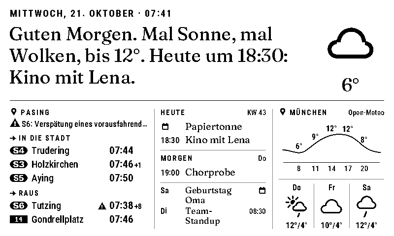

  <picture>
    <source media="(prefers-color-scheme: dark)" srcset="docs/images/logo-white.png">
    
  </picture>

InkTavla is a firmware for a 7.5" e-paper display that shows the day at a
glance: the next departures of your station in Munich, the weather and your
calendar, below a short sentence that sums them up ("Guten Morgen. Mal
Sonne, mal Wolken, bis 12°. Heute um 18:30: Kino mit Lena."). Everything runs
on the display itself; no server, no account, no app. It is set up in the
browser of your phone or computer.

<!-- Photo of the display: docs/images/display.png (to be added) -->

  

**Install: <https://fluddel94.github.io/InkTavla/>** (Chrome or Edge on a
computer)

## What you need

- The [Seeed TRMNL 7.5" (OG) DIY Kit](https://wiki.seeedstudio.com/trmnl_7inch5_diy_kit_main_page/)
  (XIAO ESP32-S3 Plus, EE04 driver board, 7.5" 800×480 black-and-white
  panel). It is the only hardware InkTavla is tested on.
- A USB-C cable that carries data, and a computer with Chrome or Edge
  (Firefox from version 151 works too) for the installation.
- A Wi-Fi with 2.4 GHz (the display does not use 5 GHz).

## Installing

1. Open the **[web installer](https://fluddel94.github.io/InkTavla/)** and
   connect the display with the USB cable.
2. Press **Install InkTavla**, choose the serial port of the display and
   wait about a minute.
3. Enter your Wi-Fi when asked (Improv). The name and password go straight
   to the display and stay there.

The display restarts and opens its settings page by itself. Details and
other ways to install: [docs/updating.md](docs/updating.md). Problems:
[docs/troubleshooting.md](docs/troubleshooting.md).

## Setting it up

Press **KEY3** on the display: it shows an address, a six-digit code and a
QR code. Scan the QR code with your phone (or open the address in a
browser in the same Wi-Fi and enter the code). On the settings page you
choose the station, the place for the weather, the calendar address and
the arrangement of the screen, then **Speichern und neu starten** / **Save
and restart**. The page closes by itself after 30 minutes.

More: [the settings page](docs/settings-page.md),
[the screen and its sentence](docs/screen.md),
[the configuration file](docs/configuration.md).

## Widgets

| Widget | Shows | Data from |
|---|---|---|
| [Departures](docs/widgets/departures.md) | Departures of one or two stations, in one list or in two directions, with delays, cancellations and disruptions | MVG (Munich area only) |
| [Weather](docs/widgets/weather.md) | Today as a curve with symbols, the next days | Open-Meteo |
| [Calendar](docs/widgets/calendar.md) | Today, the next day with events and the rest of the week | Your calendar's private iCal address (Google, Outlook, Nextcloud, iCloud, …) |

The screen shows three of them below the band, or two in wide columns.

## Buttons

The three buttons of the EE04 board:

| Button | Short press |
|---|---|
| KEY1 | Fetch everything now and refresh the whole panel |
| KEY2 | Show the system page (state and log, see [docs/system-log.md](docs/system-log.md)); again: back |
| KEY3 | Open the settings page (close it when open) |

## Updating

On the settings page, **Gerät / Device → Firmware → Nach Updates suchen /
Check for updates** installs a new release over Wi-Fi; settings, Wi-Fi and
the calendar address stay. If the new version does not start properly, the
display goes back to the previous one by itself.
See [docs/updating.md](docs/updating.md) and the [changelog](CHANGELOG.md).

## Help

- [Troubleshooting](docs/troubleshooting.md): what the texts on the display
  mean, Wi-Fi problems, starting over.
- [System log](docs/system-log.md): KEY2 or the page *System* of the
  settings page tells why data is missing or the Wi-Fi drops.
- Found a bug? [Open an issue](https://github.com/Fluddel94/InkTavla/issues/new/choose).
  Please never post your Wi-Fi password, your calendar address or other
  personal details.

## Privacy and data sources

- The display only talks to the services you set up, and to a time
  server. No account, no telemetry. The update button asks GitHub for the
  newest release only when you press it.
- Your Wi-Fi password and your calendar address are kept only on the
  display, in its protected storage; they cannot be read back, not even on
  the settings page, and are never written to the log.
- The settings page uses plain HTTP: use it only in your private home
  network ([why](docs/settings-page.md#security)).
- **Departures** come from the **unofficial** MVG API, which is not
  affiliated with or endorsed by MVG, MVV or DB and may change or stop
  working at any time.
- **Weather data by [Open-Meteo.com](https://open-meteo.com/)**, licensed
  under [CC BY 4.0](https://creativecommons.org/licenses/by/4.0/). The free
  API is for non-commercial use only; the source is named in the title of
  the weather column. Changes: values are rounded, and the symbol of a day
  is computed from its hourly values.
- **Calendar:** your own calendar, requested only from the service that
  publishes it.

## Contributing

How to build, test and change InkTavla: [CONTRIBUTING.md](CONTRIBUTING.md).

- InkTavla is developed with the help of Claude, Anthropic's AI assistant;
  every change is reviewed and committed by the maintainer.
- Because this is stated here once, commits, pull requests and files carry no
  AI notes of their own (no co-author lines or "generated with" footers),
  and links to AI chat sessions are never added: they can lead to private
  conversations, and once the repository is public they stay in its history
  (pull requests cannot be deleted). For contributors this is a request, not
  a requirement; CI only warns (`tools/check_ai_notes.py`).

## Credits

| Library | Version | License | Used for |
|---|---|---|---|
| [ArduinoJson](https://arduinojson.org/) | 7.4.3 | MIT | Reading API responses |
| [QR Code generator](https://www.nayuki.io/page/qr-code-generator-library) (C) | 1.8.0 | MIT | QR code of the settings notice, copied into `lib/qrcodegen` |
| [Unity](https://www.throwtheswitch.org/unity) | 2.6.1 | MIT | Unit tests only |
| [Roboto Condensed](https://github.com/googlefonts/roboto-classic) (font) | 3.008 | SIL OFL 1.1 | Text on the display, converted by `tools/fontgen` |
| [Fraunces](https://github.com/undercasetype/Fraunces) (font) | 1.000 | SIL OFL 1.1 (no Reserved Font Name) | Sentence and events of the "Briefing" layout, converted by `tools/fontgen` |
| [Pillow](https://python-pillow.org/) | 12.3.0 | MIT-CMU | Font generator only, not part of the firmware |
| [esptool](https://github.com/espressif/esptool) | 5.6.0 (pioarduino) | GPL-2.0-or-later | Merges `firmware-full.bin` during the build; a build tool, not part of the firmware |
| [ESP Web Tools](https://github.com/esphome/esp-web-tools) | 10.4.0 | Apache-2.0 | Web installer page only (bundles esptool-js, Lit, Material Web, tslib), downloaded from npm when the site is built, not part of the firmware or the repository |

MVV line symbols (S-Bahn, U-Bahn): from Wikimedia Commons ("München S1.svg"
etc. by Claus Färber, marked as public domain), converted to 1 bit. They may
be trademarks of MVV, MVG or DB. Tram and night tram symbols are our own.

Weather symbols, the large weather pictures of the "Briefing" layout and the
small symbols (calendar, location pin, stop sign) are our own, drawn by `tools/icongen`
(Pillow).

## License

InkTavla is free software: you can redistribute it and/or modify it under the
terms of the GNU General Public License as published by the Free Software
Foundation, either version 3 of the License, or (at your option) any later
version. It is distributed in the hope that it will be useful, but without any
warranty; without even the implied warranty of merchantability or fitness for
a particular purpose. The full text is in [LICENSE](LICENSE)
(SPDX: `GPL-3.0-or-later`).

Copyright (C) 2026 Fluddel94

Exceptions:

- The fonts (Roboto Condensed, Fraunces) are under the SIL Open Font License
  1.1; the license texts are in `lib/ui/src/ui/fonts/`.
- `lib/qrcodegen` is under the MIT license (see its `README.md`).
- The MVV line symbols are public domain, but may be trademarks (see
  [Credits](#credits)).
- Design files are under
  [CC BY-NC-SA 4.0](https://creativecommons.org/licenses/by-nc-sa/4.0/), with
  a `LICENSE` of their own in their folder: the logo in
  [`docs/images/`](docs/images/); the case (3D models) will follow.
