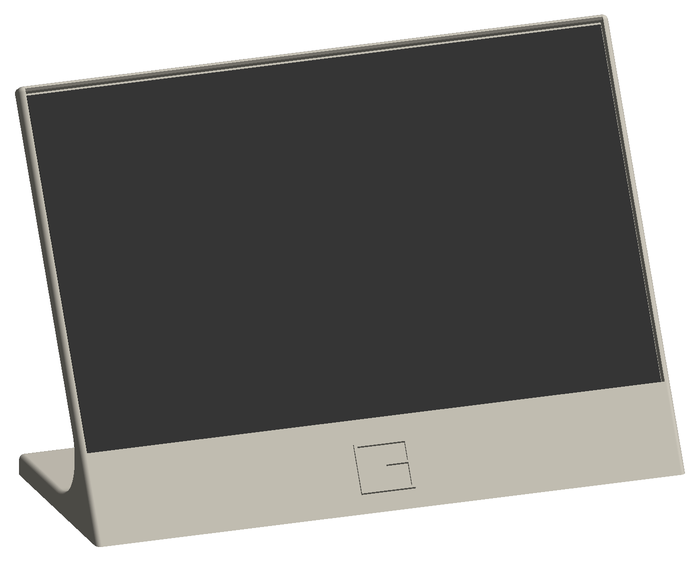
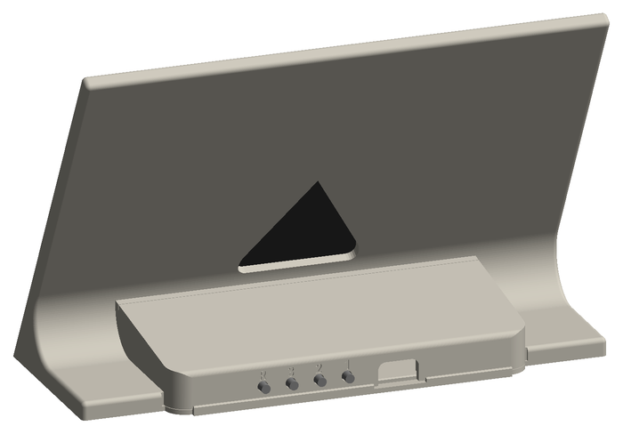

# The case

A 3D-printed stand for the [Seeed TRMNL 7.5" (OG) DIY Kit](https://wiki.seeedstudio.com/trmnl_7inch5_diy_kit_main_page/):
the display leans back by 29°, the board sits behind it, and the three
buttons and the reset button are pressed from behind. No screws and no glue;
the display can be taken out again.

  
  

**Download:** on [MakerWorld](https://makerworld.com/models/3703269-slim-stand-for-seeed-trmnl-7-5-og-diy-kit) (STL files and
print profiles for Bambu Lab printers) or from [`case/`](../case/) in this
repository; both have the same files. They are under
[CC BY-NC-SA 4.0](https://creativecommons.org/licenses/by-nc-sa/4.0/), not
under the GPL of the firmware (see [License](#license)).

## Which one?

| | Slim | Slim+Battery |
|---|---|---|
| Power | USB cable | USB cable; room for the kit's battery |
| Size (W × D × H) | 175 × 72 × 115 mm | 175 × 75 × 119 mm |
| Strip below the picture | about 25 mm | about 30 mm |
| Tested | printed and tested | built from the same tested parts, not printed in this exact version |

**Slim** is the one to print if the display stays in one place. **Slim+Battery**
holds the kit's battery below the board. InkTavla currently needs USB power
(it fetches departures every minute and does not sleep), so the battery only
bridges a short move, for example to another room.

Both look the same from the front. They share the frame, the way the panel is
inserted, the guide for the display cable (FPC), the lid and the buttons; Slim
has the board 4.4 mm lower, so its stand is lower.

## Printing

| File | Part | Print with |
|---|---|---|
| `…-case.stl` | frame with stand and board holder | the floor on the bed (as it is in the file) |
| `…-lid.stl` | lid with the four button holes | the top on the bed (as it is in the file) |
| `…-plungers-6x.stl` | four plungers for the buttons and two spare | as they are |

The files are already in print orientation; do not scale them. All parts fit
on a bed of 180 × 180 mm.

- **PLA**, 0.4 mm nozzle, layer height 0.2 mm (plungers 0.12–0.16 mm),
  **4 walls**, 15 % infill, **no supports** (turn supports off completely:
  in the cable guide they could not be removed).
- The back plate is tall and thin. On a printer with a moving bed, lay the
  long side (175 mm) **parallel to the movement of the bed**. If the plate
  shifts high up, slow down the outer walls above about 60 mm (a height range
  modifier in the slicer), and use Z-hop on travel moves.
- Check in the slicer preview: the underside of the rim above the display, the
  bridge over the cable opening, the text inside the case and the labels on
  the lid's back wall.

## Assembling

You need the display, the board (EE04 with the XIAO ESP32-S3 Plus) and its
antenna, and for Slim+Battery the battery. The case holds everything by shape:
the panel leans in its frame, the board lies in four corner pieces, and posts
of the lid press it down.

1. **Display:** stand the panel with its bottom edge (the cable side) in the
   slot behind the lip at the bottom of the frame, top tilted slightly
   forward, then swing the top back until the panel rests against the back
   plate. The cable is guided backwards under the panel; take its end from
   behind. The panel is not clamped: it rests by the tilt, so do not tip the
   case forward when carrying it.
2. **Board:** hold the board with its components facing down above the four
   corner pieces, plug the display cable into its connector and close the
   latch, then lower the board straight into the corner pieces. Slim+Battery:
   now put the battery under the board and plug it in.
3. **Antenna:** lay it loosely on the board, not under the posts at the
   corners; there is room next to the board.
4. **Plungers:** stand the lid on its back wall (inside up) and push the four
   plungers into the holes from the inside; they rest on their collar.
5. **Lid:** tilt the lid by about 20° with its front edge up, so the plungers
   stay in. Put the bottom of the back wall into the groove at the back of the
   floor, then press the front edge down until the tongues snap in at the sides
   and at the front.

**Opening:** push the lid up at the USB opening from below until the side
tongues let go, then lift it to the back. **Taking the display out:** unplug
the cable at the board, then push the panel forward through the cutout in the
back plate until its top comes out of the rim.

The buttons are labelled **R 3 2 1** from behind, left to right: R is reset,
1 to 3 are KEY1 to KEY3 of the board (see [Buttons](../README.md#buttons)).

## Changing the case

The case is drawn in Python with [CadQuery](https://cadquery.readthedocs.io/);
every STL is made by `case/source/inktavla_case.py`. How to change and check
it: [`case/README.md`](../case/README.md).

## Inspired by

The case is our own design; no geometry was taken from other models. Ideas
came from these cases on MakerWorld (thank you):

- [Weather E-Ink 7.5inch Display](https://makerworld.com/models/2285672)
  by dbunndesign: a cutout in the back plate to push the display out.
- [Remixed Upgrated Triangular Prism 3D Enclosure](https://makerworld.com/models/2906389)
  by Burt0n_87 (a remix of Seeed Studio's triangular prism enclosure): the
  frame with a narrow rim around the display.

## License

The case (the STL files, the pictures in `case/` and the source in
`case/source/`) is Copyright (C) 2026 Fluddel94 and licensed under
[CC BY-NC-SA 4.0](https://creativecommons.org/licenses/by-nc-sa/4.0/): you
may print, share and change it, not for commercial purposes, with credit, and
changed versions under the same license. The full text is in
[`case/LICENSE`](../case/LICENSE). The font used for the labels (Roboto
Condensed) is under the SIL Open Font License 1.1
([`case/source/fonts/OFL.txt`](../case/source/fonts/OFL.txt)).
