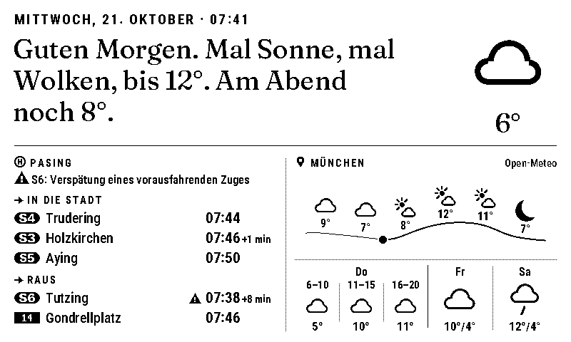

# The screen

At the top a band with the date, the time, a sentence and a weather
picture; below it two or three columns with the widgets. This page explains
how the screen is laid out and how the sentence of the band is made. The
columns of the widgets are described on their own pages:
[departures](widgets/departures.md), [weather](widgets/weather.md),
[calendar](widgets/calendar.md).

## Updates and old data

- The clock is redrawn every minute. Departures are fetched once a minute,
  the weather every 30 minutes and the calendar every 15 minutes (or as
  set); new departures appear with the next minute, new weather or calendar
  data at once.
- Only the changed areas of the panel are refreshed. Every
  `display.full_refresh_minutes` (6 hours by default) the whole panel is
  refreshed against ghosting (the panel flickers briefly).
- Short disturbances of up to 60 s are bridged silently. After that a
  widget shows its last data with the badge "Stand 14:32"; a widget that
  never had data shows "Keine Verbindung". A failing widget only affects
  its own column. A lost Wi-Fi connection is likewise only shown (a
  struck-through Wi-Fi symbol after the time) after 60 s; the display
  keeps reconnecting in the background.
- Columns that are not set up yet say what is missing and "Auf der
  Einstellungsseite einrichten (Taste 3)".

## Layouts and columns

The screen has two layouts: **band + 3** (three columns) and **band + 2**
(two wide columns). The layout follows from the number of widgets chosen
on the settings page (page *Layout und Darstellung*) or in `layout.slots`
(see [configuration.md](configuration.md#general-settings)).

The columns only come in three widths, the size steps **S** (214 px),
**M** (280 px) and **L** (367 px); they are 260 px high.

| `layout.slots` | Layout | Columns |
|---|---|---|
| 3 entries | band + 3 | one of M and two of S: 280 \| 214 \| 214 px |
| 2 entries | band + 2 | two of L: 367 \| 367 px |

In band + 3 the wide column (M) is the first one from the left whose widget
needs M, so `["calendar", "weather", "mvg"]` gives 214 | 214 | 280 px.
Without such a widget the first column is the wide one.

The columns are 26 px apart, with dotted lines in the middle that can be
switched off (`layout.dividers`). Band + 2 with departures and weather:

Every widget has a smallest step and goes into every column of at least
that width:

| Widget | Smallest step |
|---|---|
| `mvg` | M (280 px) |
| `weather` | S (214 px) |
| `calendar` | S (214 px) |

A widget in a column that is too narrow for it - a second one that needs M
in band + 3 - is reported (`layout.slots: widget "mvg" does not fit slot 3
(214 px); it needs 280 px`) and the column shows "Passt hier nicht" instead
of a clipped view; another number of entries than 2 or 3 is reported
(`layout.slots: must have 2 or 3 entries`) and the standard is used.

The screen keeps a margin of 20 px at the left, right and top (the capitals
of the date line start 20 px from the top) and 15 px at the bottom. The
margins are two constants in the firmware (`kMargin` and `kMarginBottom` in
`lib/ui/src/ui/layout.h`), in case a case covers the edge of the panel; the
steps M and L follow from them (S stays 214 px).

## The band

At the top a band with the date and time, a sentence and a weather picture
with the temperature of now ("Jetzt 8°"); below two or three columns without frames
that are filled down to the bottom edge. The sentence follows fixed rules
(no AI): a greeting by the time of day ("Guten Morgen" until 11:00, "Guten
Tag" until 18:00, then "Guten Abend"), then

1. without Wi-Fi for 60 s: "Keine Verbindung zum WLAN – die Angaben sind
   von 07:12." (shorter "Kein WLAN – Stand 07:12." if that makes room for
   the rest; and a struck-through Wi-Fi symbol after the time); with Wi-Fi,
   widgets on the screen whose updates have failed for 60 s: "Die Abfahrten
   lassen sich gerade nicht abrufen – Stand 07:12.", "Wetter und Kalender
   lassen sich gerade nicht abrufen.";
2. a cancelled departure among the next two departures of each direction
   (or station), within the next hour, at most one (the earliest): "Die S2
   um 07:54 nach Dachau fällt aus.";
3. always a sentence about the weather, by the time of day:
   - until 11:00 the whole day: "Heute wird es sonnig, bis 16°.", "Erst
     trocken, ab 16 Uhr Regen – Schirm mit. Bis 14°.", "Heute regnet es den
     ganzen Tag – Schirm mit. Höchstens 9°.", "Ab 9 Uhr schneit es, um 0° –
     es kann glatt werden.", "Sonnig und heiß, bis 32°.";
   - then the afternoon and the evening (temperature at 20:00): "Der
     Nachmittag bleibt sonnig, am Abend 11°.", "Ab 16 Uhr regnet es –
     Schirm mit. Am Abend 9°.", "Es regnet noch bis etwa 17 Uhr, danach
     trocken. Am Abend 8°."; after sunset the evening: "Ein klarer,
     trockener Abend, später 5°.";
   - tomorrow from the first full hour after sunset, but not before 18:00
     and not after 21:00 (in Munich 18:00 in winter, 21:00 in June):
     "Morgen wird es sonnig, 4° bis 15°.", "Morgen früh Nebel, später
     sonnig, bis 12°.", "Morgen ab 10 Uhr Regen – Schirm einpacken. Bis
     11°.", "Morgen zeitweise neblig, sonst trocken, bis 11°.", and if
     tomorrow's high differs by 8° or more "Morgen wird es deutlich kälter:
     höchstens 6°, wolkig.".

   The sentence and the symbols do not contradict each other. Today the
   sentence talks about the same weather as the band picture and uses the
   same rain rule: "Schirm mit" exactly when the picture is the umbrella (a
   probability of 70 % in one of the hours ahead), "vielleicht Regen" from
   30 % or when the hours bring rain by their amounts. Tomorrow the weather
   word is the daily code of Open-Meteo, as the symbol in the weather
   column; the hours give the times, "Schirm einpacken" only if that symbol
   shows rain, and weather of the code that is only at night is
   "zeitweise". For the same dry weather there are up to three wordings; the
   date and the time of day pick one, so it does not change with every
   refresh.

   Wind (gusts from Open-Meteo, as the warning levels of the German
   weather service, without speeds): from 50 km/h "Dazu windig mit
   kräftigen Böen." (only if there is room), from 65 km/h "Stürmisch,
   Sturmböen möglich." and "Kapuze statt Schirm" instead of "Schirm mit",
   from 105 km/h "Achtung, orkanartige Böen."; today the hours still
   ahead, in the evening tomorrow 06:00 to 22:00 ("Morgen stürmisch, …").

   The band picture: the umbrella with two, four or six drops by the
   intensity of the likely rain (snow as one flake or three, a
   thunderstorm with hail grains); from gusts of 65 km/h in the hours
   still ahead today a windsock instead of a dry sky, a windsock with
   driven rain instead of the umbrella and a snowflake with wind lines for
   snow (a thunderstorm stays).

4. the next event of the calendar (if the calendar is on the screen): until
   the evening (the hour from which the weather sentence talks about
   tomorrow) the next event of today that has not begun yet, "Um 09:30
   Zahnarzt.", or, if no event with a time is left today, an all-day event
   that begins today, "Heute: Geburtstag Oma."; in the evening the first
   event of tomorrow, "Morgen um 08:00 Zahnarzt.", "Morgen: Geburtstag
   Oma.". Events of several days are named on their first day only; the
   settings of the calendar column (`all_day`, `exclude`) apply.

Disruption messages are not part of the sentence; they are shown in their
column. The parts stand side by side in this order; the sentence has at
most three lines in Fraunces 38 (never a smaller size).

**Length of the sentence.** Every part comes in up to three forms, and the
band picks them so that the sentence fills at least half and at most about
85 % of its three lines (the width of the whole sentence in Fraunces 38):
if only one widget has something to say, it tells more; if several do,
they get shorter. Of the combinations that fit within that range, the
higher rank keeps the longer form, so the event gets shorter first, then
the weather, then a cancellation or a notice. If none is within the range,
the band takes one that reaches half and goes least beyond it; if all stay
below half, the longest.

| Part | Longer | Usual | Shorter |
|---|---|---|---|
| Notice | – | "Keine Verbindung zum WLAN – die Angaben sind von 07:12." | "Kein WLAN – Stand 07:12." (failed updates without the time) |
| Cancellation | "…, die nächste fährt um 08:14." (next departure of the same line to the same destination) | "Die S2 um 07:54 nach Dachau fällt aus." | "S2 um 07:54 fällt aus." |
| Weather | a look ahead: in the morning "Am Abend noch 9°.", in the afternoon the sentence about tomorrow, in the evening "Heute Nacht bis 2°." | as above | without the temperature ("Heute wird es sonnig."); a storm stays |
| Event | "…, danach um 14:00 Elternabend." (next event with a time of the same day) | "Um 09:30 Zahnarzt." | "09:30 Zahnarzt.", "Morgen 08:00 Zahnarzt.", "Heute: Geburtstag Oma.", title shortened with "…" |

English in the same way ("S2 at 07:54 cancelled.", "Still 9° in the
evening.", "Down to 2° tonight.", "…, then Elternabend at 14:00."). Only if
even the shorter forms of all parts do not fit, the greeting is left out,
then the part of the lowest rank (the event first). This happens only
when much comes together, e.g. no Wi-Fi, a cancellation, a storm and an
event. With nothing else to say the greeting names the weekday: "Guten
Morgen und einen schönen Dienstag.", "Guten Tag und noch einen schönen
Dienstag.", "Guten Abend und einen schönen Dienstagabend." ("Good morning,
have a nice Tuesday."). Parts of sources without fresh data are left
out. The band reads the weather section (`widgets.weather`) even if the
weather column is not on the screen, the departures and the calendar only
if they are on the screen. Every widget has a switch `band` in its section
that takes its part out of the sentence: `widgets.weather.band: false`
leaves out the weather sentence (the picture stays), `widgets.mvg.band:
false` the cancellation, `widgets.calendar.band: false` the event. The notes on failed updates do not depend on it. Without a
weather column, `widgets.weather.band: false` also stops the weather from
being fetched; the band then shows a dotted cloud and "–°" in place of the
picture and the temperature (as it does when no place is set). The picture shows by daylight the weather of the rest of the
daylight hours (the umbrella with drops for likely rain, a cloud for rain
that is only possible), at night the weather of now.
